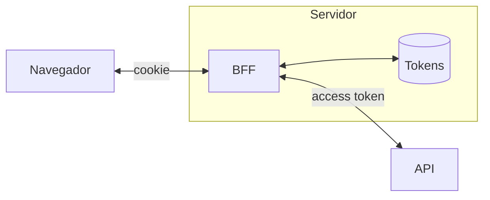

En una aplicación web, el navegador no es un lugar ideal para guardar credenciales que permiten llamar directamente a nuestras APIs. Si un access token acaba en `localStorage`, cualquier JavaScript que se ejecute en el origen puede leerlo. Una vulnerabilidad XSS puede convertir ese token en una llave reutilizable desde otro equipo: alguien se hace pasar por el usuario mientras el token siga vigente.

El patrón **Backend for Frontend (BFF)** nos ayudó a cambiar ese límite de confianza. En vez de entregar el token a la aplicación JavaScript, el servidor lo conserva y hace las llamadas a las APIs en nombre del usuario.

## El flujo



El navegador solo conoce una cookie de sesión. El BFF mantiene los tokens OAuth en el servidor, o en un almacén compartido protegido, y los añade a las peticiones que reenvía a las APIs.

```mermaid {caption="Inicio de sesión con OAuth y una llamada posterior a la API a través del BFF."}
sequenceDiagram
  accTitle: Inicio de sesión y llamadas a través del BFF
  accDescr: El usuario completa OAuth con el proveedor de identidad. El BFF canjea el código por tokens, los guarda en la sesión y entrega al navegador una cookie HttpOnly, Secure y SameSite. Después, el navegador llama al BFF con esa cookie; el BFF valida la sesión y llama a la API con el access token.
  participant N as Navegador
  participant B as BFF
  participant I as Proveedor de identidad
  participant A as API
  N->>B: Iniciar sesión
  B-->>N: Redirige al proveedor
  N->>I: Se autentica
  I-->>N: Redirige con un código
  N->>B: Entrega el código
  B->>I: Canjea el código por tokens
  I-->>B: Tokens
  Note over B: Guarda los tokens en la sesión
  B-->>N: Cookie HttpOnly, Secure y SameSite
  N->>B: Llamada con la cookie
  Note over B: Valida la sesión
  B->>A: Llamada con el access token
  A-->>B: Respuesta
  B-->>N: Respuesta
```

Así evitamos que un token bearer de larga duración pase por el código del cliente. Si alguien consigue ejecutar JavaScript malicioso, ya no puede simplemente leer el access token y llevárselo para reproducirlo desde otro sitio.

## Qué problema nos resolvió

Antes, el navegador tenía una credencial que podía presentarse directamente ante la API. El riesgo no era solo que alguien viera el token: como es una credencial *bearer*, quien lo posee puede usarlo hasta que expire o se revoque. Eso abre la puerta a la suplantación de la sesión desde otro cliente.

Con el BFF, el access token no se entrega al navegador. La sesión queda ligada a una cookie protegida y el BFF actúa como intermediario. También ganamos un punto central donde renovar o revocar tokens, limitar scopes y evitar que el cliente tenga que conocer detalles del proveedor de identidad.

## Lo que el BFF no arregla

Un BFF **no elimina el impacto de XSS**. Un script malicioso quizá no pueda leer una cookie `HttpOnly`, pero sí puede realizar acciones con la sesión abierta desde la propia página. Hay que prevenir XSS y proteger las operaciones sensibles.

Tampoco desaparece el riesgo de CSRF: el navegador adjunta cookies automáticamente. `SameSite` ayuda, pero hay que definir la defensa según el flujo y el tipo de operación, por ejemplo, validar el origen y usar una protección anti-CSRF cuando corresponda.

Y el BFF no reemplaza la autorización de la API. La API sigue teniendo que validar el token, comprobar scopes y permisos sobre cada recurso. El BFF no debería convertirse en un proxy que permita llamar cualquier endpoint con privilegios amplios.

## El coste de la decisión

Este patrón añade trabajo en el servidor: gestionar sesiones, proteger y compartir el almacenamiento entre instancias, renovar tokens, cerrar sesiones y observar fallos de autenticación. También añade un salto de red. Para una aplicación con datos sensibles o una API que no debe exponerse directamente al navegador, suele ser un intercambio razonable; para otras, conviene comparar ese coste con el modelo de cliente público y sus controles.

La mejora importante fue reducir la cantidad de credenciales que el navegador puede robar y reutilizar. No hicimos desaparecer los ataques de sesión: movimos los tokens a un lugar donde podemos protegerlos mejor y dejamos más claro qué componente responde por cada decisión.

## Referencias

- [OWASP: Session Management Cheat Sheet](https://cheatsheetseries.owasp.org/cheatsheets/Session_Management_Cheat_Sheet.html)
- [OWASP: Cross Site Scripting Prevention Cheat Sheet](https://cheatsheetseries.owasp.org/cheatsheets/Cross_Site_Scripting_Prevention_Cheat_Sheet.html)
- [OWASP: Cross-Site Request Forgery Prevention Cheat Sheet](https://cheatsheetseries.owasp.org/cheatsheets/Cross-Site_Request_Forgery_Prevention_Cheat_Sheet.html)
- [RFC 9700: Best Current Practice for OAuth 2.0 Security](https://www.rfc-editor.org/rfc/rfc9700.html)